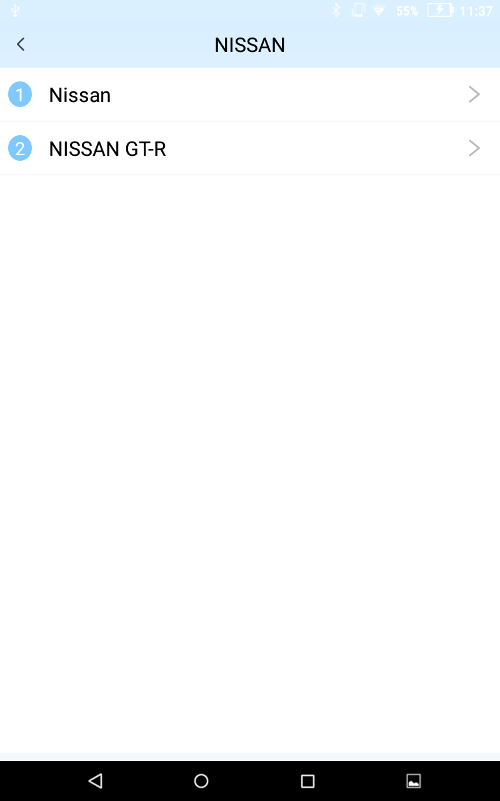

# MAXOBD en Android 5: instalación completa y paquetes por marca

## Estado comprobado al 16 de noviembre de 2026

El proyecto documenta la reparación del arranque y la recuperación de los paquetes desde sus servidores originales. Caso real: **Lenovo TAB 2 A8-50F-YZ-A, Android 5.1/API 22**. La instalación final quedó en **MAXOBD 1.1.01/código 57, armeabi-v7a + hdpi**.

| Problema | Resultado |
|---|---|
| Recurso gráfico ausente al abrir 1.0.30 | Resuelto instalando juntos base, gráficos y bibliotecas |
| «Descarga fallida» al obtener Nissan | Catálogo y archivos disponibles; se recuperaron y copiaron los 23 archivos originales |
| Faltaban las demás marcas | **19 grupos, 2.875 archivos y 907.211.045 bytes** descargados y copiados |
| Cierres posteriores durante el uso | Se registró un fallo interno JNI; **sigue pendiente**, no se corrigió copiando datos |

Todos los originales se verificaron por tamaño, MD5 y SHA-256 en la computadora. En la tableta se comprobaron los **2.875 tamaños** y una muestra MD5 por grupo: **19/19 correctas**. La app abrió el menú Nissan y el usuario confirmó que funcionaba. No se probaron todas las marcas con vehículos reales.



Documentación del progreso: [seguimiento](docs/seguimiento.md), [servidores](docs/servidores.md), [paquetes](docs/paquetes.md), [capturas](docs/evidencias.md) y [cambios](CHANGELOG.md).

## Descargar y copiar los paquetes de las marcas

[`paquetes_maxobd.py`](paquetes_maxobd.py) utiliza solo la biblioteca estándar de Python 3.9+. El [catálogo público](datos/catalogo-paquetes-2026-11-16.json) contiene las rutas oficiales, tamaños, MD5 y SHA-256 de los 2.875 archivos; el [inventario CSV](datos/grupos.csv) facilita consultar los grupos. Los [resultados del caso](datos/resultado-caso-2026-11-16.json) no contienen identificadores privados.

```sh
# Solo inventario, sin red ni ADB.
python3 paquetes_maxobd.py

# Un grupo; omite --marca para descargar todos.
python3 paquetes_maxobd.py --marca nissan --descargar --destino datos-locales
python3 paquetes_maxobd.py --descargar --destino datos-locales --hilos 8

# Solo verificar los originales, sin red ni cambios.
python3 paquetes_maxobd.py --verificar --destino datos-locales

# Copiar a la versión probada 1.1.01; requiere un destino nuevo de respaldo.
python3 paquetes_maxobd.py --copiar --destino datos-locales --respaldo respaldo-maxobd
```

En Windows usa `py -3` y, si hace falta, `--adb "C:\Android\platform-tools\adb.exe"`. Con varios dispositivos, añade `--serial SERIAL`. El copiador verifica los archivos, cierra MAXOBD, respalda sus **archivos externos**, copia únicamente los seleccionados y comprueba tamaños y una muestra por grupo. No inicia diagnósticos del vehículo. El respaldo no incluye cuentas, preferencias o bases privadas internas.

Se incluye español donde existe, más archivos comunes. VAZ ofrece inglés y ruso; se conservan ambos. Toyota mantiene **NA/JP/EU** separadas para no sobrescribir binarios con nombres iguales. Los archivos grandes se descargan por bloques con verificación de rangos y reintentos contra los endpoints oficiales del mismo bucket.

Los APK/XAPK y los 907 MB propietarios no se redistribuyen dentro de Git. Los metadatos y el descargador permiten obtener los archivos exactos desde el fabricante, sujetos a su disponibilidad. La licencia MIT cubre el código y la documentación propios, no el contenido de MAXOBD.

## Reparación original del arranque

Guía e instalador para corregir el cierre de MAXOBD provocado por una **instalación incompleta del XAPK**. Instala juntos el APK principal, los gráficos y las bibliotecas de la misma versión, conservando los datos de la aplicación.

**Caso comprobado:** MAXOBD **1.0.30** abrió correctamente en una **Lenovo TAB 2 A8-50F-YZ-A con Android 5.1/API 22**, después de completar sus componentes. No fue necesario actualizar Android, desbloquear el bootloader, obtener root ni modificar el APK.

Android **5.0/API 21 es el mínimo declarado por los perfiles compatibles examinados**; la prueba real fue en Android 5.1. El conjunto 1.1.04 inspeccionado exige API 24/Android 7.0 y no se instaló. El seguimiento posterior con el vehículo está documentado arriba y no acredita estabilidad completa.

## Qué problema resuelve

Un XAPK puede contener varios APK. Instalar únicamente el principal deja fuera recursos y bibliotecas. En el caso diagnosticado, Logcat mostraba:

```text
java.lang.RuntimeException: Unable to start activity
Caused by: android.content.res.Resources$NotFoundException: Resource ID #0x7f070105
    at com.jiawei.maxobd.obd.ObdHomeMainfragment.onCreateView
```

El gráfico `ic_iv_rightselect` sí estaba en `config.xxhdpi.apk`; faltaba instalar ese componente y el de bibliotecas `config.arm64_v8a.apk`.

## Instalación rápida

Necesitas una computadora con **Python 3.9 o superior**, [Android SDK Platform Tools oficiales](https://developer.android.com/tools/releases/platform-tools), un cable USB de datos y el **XAPK completo de una combinación reconocida**. No necesitas bibliotecas de Python adicionales.

1. Descarga este repositorio con **Code → Download ZIP** y extráelo, o clónalo:

   ```sh
   git clone https://github.com/Damiselo999/maxobd-android5-installer.git
   cd maxobd-android5-installer
   ```

2. Obtén tu copia original del XAPK. En el caso comprobado ya estaba descargada desde APKPure. El repositorio contiene herramientas y hashes; **no aloja APK ni XAPK de MAXOBD**. El fabricante publica MAXOBD en [Google Play](https://play.google.com/store/apps/details?id=com.jiawei.maxobd); [APKPure mantiene una ficha e historial](https://apkpure.net/maxobd/com.jiawei.maxobd). La disponibilidad de las ediciones antiguas puede cambiar.

3. Activa **Opciones de desarrollador → Depuración USB**, conecta el equipo y acepta en la tableta el aviso **«¿Permitir depuración USB?»** correspondiente a tu computadora.

4. Comprueba el XAPK y la compatibilidad del dispositivo. Por defecto **no se instala nada**:

   ```sh
   python3 instalar_maxobd.py --xapk "/ruta/a/MAXOBD.xapk"
   ```

5. Aplica la instalación completa:

   ```sh
   python3 instalar_maxobd.py --xapk "/ruta/a/MAXOBD.xapk" --instalar
   ```

6. Abre MAXOBD en la tableta y comprueba la interfaz. El programa también muestra el comando ADB para abrirla; no inicia diagnósticos del vehículo.

En Windows cambia `python3` por `py -3`. Si ADB no está en PATH, usa `--adb "C:\ruta\platform-tools\adb.exe"`. Consulta las guías de [Windows](docs/windows.md) y [Linux/macOS](docs/linux-macos.md).

### Combinaciones reconocidas

| MAXOBD | Componentes del XAPK | Android mínimo declarado | Validación |
|---|---|---|---|
| **1.0.30**, código 46 | Base + ARM64 + xxhdpi | 5.0 / API 21 | **Inicio, interfaz y búsqueda BLE probados en Android 5.1** |
| 1.0.29, código 44 | Base + armeabi-v7a + hdpi | 5.0 / API 21 | Solo inspección estática; ejecución no probada |
| **1.1.01**, código 57 | Base + armeabi-v7a + hdpi | 5.0 / API 21 | Instalación final y paquetes recuperados; cierre JNI pendiente |

El instalador valida los **hashes exactos** de estas copias. Otro XAPK de la misma versión podría incluir componentes de otra arquitectura o densidad y será rechazado. No cambies hashes para saltarte una comprobación: revisa primero la procedencia y el conjunto, o sigue el procedimiento manual con las herramientas oficiales.

## Qué hace el instalador

- Verifica el paquete `com.jiawei.maxobd`, la versión y los tres componentes contra los SHA-256 registrados en `perfiles.json`.
- Extrae únicamente los nombres previstos en una carpeta temporal; rechaza archivos duplicados, conjuntos adicionales y archivos de tamaño excesivo.
- Comprueba que la conexión ADB esté autorizada, el nivel API y la arquitectura ABI.
- Si hay varios dispositivos, exige `--serial`; no elige uno arbitrariamente.
- Rechaza reemplazar una versión distinta ya instalada. No degrada ni desinstala para forzar la instalación.
- Ejecuta `adb install-multiple -r` solo al solicitar `--instalar` y comprueba versión y número de componentes después.

Para verificar solo el archivo, sin tableta ni ADB:

```sh
python3 instalar_maxobd.py --xapk "/ruta/a/MAXOBD.xapk" --solo-archivo
```

## Procedimiento manual del caso comprobado

Extrae el XAPK como ZIP, conserva **los tres APK de la misma edición** y ejecuta desde esa carpeta:

```sh
adb devices -l
adb -s SERIAL install-multiple -r com.jiawei.maxobd.apk config.arm64_v8a.apk config.xxhdpi.apk
adb -s SERIAL shell pm path com.jiawei.maxobd
adb -s SERIAL shell am start -n com.jiawei.maxobd/.obd.ObdActivity
```

Sustituye `SERIAL` por el identificador que muestra `adb devices`. Ese comando concreto corresponde al conjunto **1.0.30/ARM64/xxhdpi** y requiere que el dispositivo soporte ARM64. Para otras combinaciones comprueba antes manifiestos, ABI, SDK, versiones y firmas; no mezcles APK entre ediciones. Android valida las firmas al instalar. Con SDK Build Tools también puedes inspeccionarlas previamente con [apksigner](https://developer.android.com/tools/apksigner).

Si Android informa de incompatibilidad de firma, versión o SDK, conserva el error para diagnosticarlo. No desinstales, borres datos o cambies protecciones como respuesta automática.

## Diagnóstico y límites

- [Diagnóstico del cierre y solución comprobada](docs/diagnostico.md).
- [SDK, arquitecturas, firmas y alcance de las pruebas](docs/compatibilidad.md).
- **No hay funciones para flashear ROMs, modificar APK, obtener root o eludir licencias.**
- El mínimo de Android depende del APK concreto; `targetSdkVersion` no es `minSdkVersion`.
- La apertura y el reconocimiento de paquetes no certifican cobertura de todos los vehículos o estabilidad de todas las funciones nativas. Los permisos se comprueban según la versión de Android.
- La lectura del vehículo debe probarse por separado. No ejecutar borrado de DTC, EVAP modo 8, activaciones, resets, codificación o programación sin autorización específica.

## Pruebas del instalador

```sh
python3 -m unittest discover -s tests -v
```

Las pruebas usan archivos sintéticos y ADB simulado. Cubren manipulación del XAPK, conjuntos incompletos, selección de dispositivo, compatibilidad y rechazo de cambios de versión; no escriben en una tableta. La reparación original sí se comprobó con una Lenovo real.

## Procedencia y licencia

Proyecto comunitario, sin afiliación con KONNWEI, Lenovo o Google. Los hashes y la huella de certificado se obtuvieron de copias aportadas por el usuario desde APKPure; permiten reconocer esos archivos, pero no certifican por sí solos al editor. No se afirma disponer de una huella oficial independiente del fabricante.

El código y la documentación propios se distribuyen bajo [licencia MIT](LICENSE). Esa licencia no se aplica a MAXOBD, sus marcas o sus archivos de aplicación. No publiques logs completos, números de serie, direcciones Bluetooth, VIN ni otros datos privados al pedir ayuda; comparte únicamente el fragmento del error necesario.

Documentación oficial: [App Bundles](https://developer.android.com/guide/app-bundle), [ADB](https://developer.android.com/tools/adb), [uses-sdk](https://developer.android.com/guide/topics/manifest/uses-sdk-element), [producto MAXOBD de KONNWEI](https://www.konnwei.com/product/470.html).
