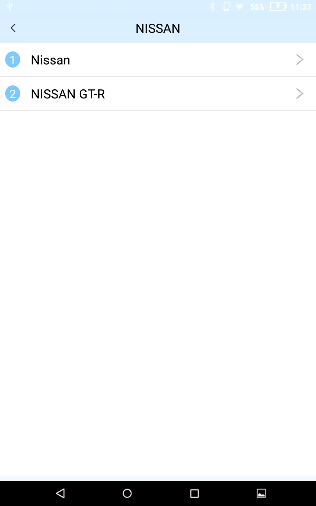
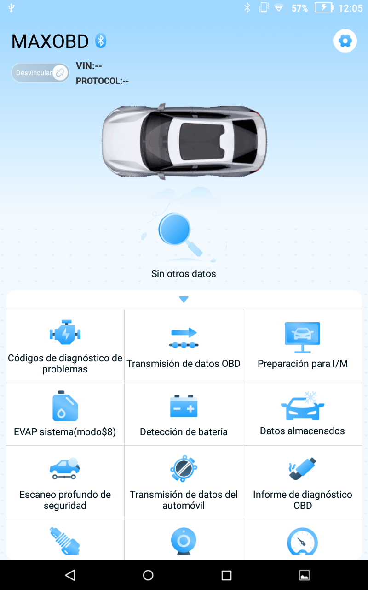
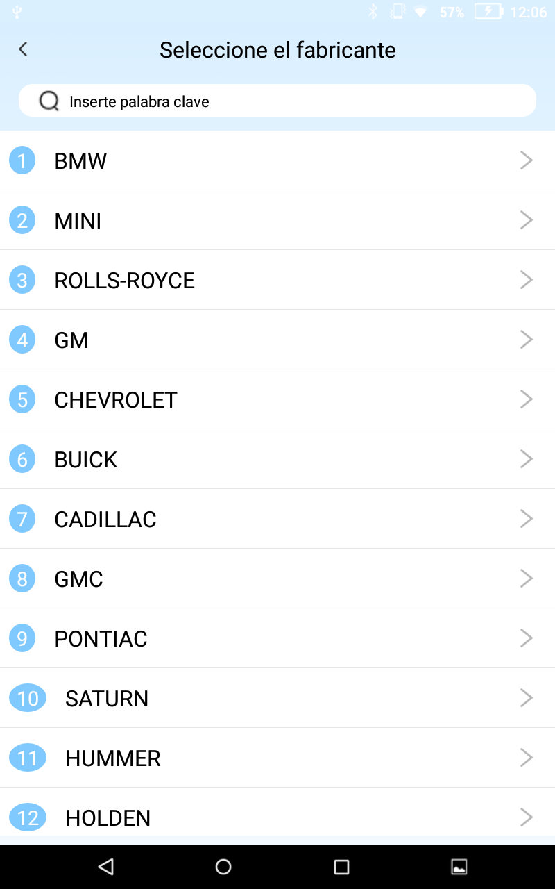
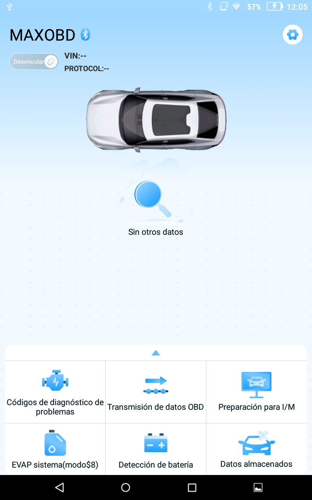

# Capturas de la Lenovo

Capturas originales de la sesión del 16 de noviembre de 2026. No se retocaron. Las seleccionadas no muestran VIN, contactos, cuentas, MAC o códigos privados.

## Nissan reconocido tras copiar sus 23 archivos

El menú y la confirmación del usuario acreditan reconocimiento del paquete, no una prueba completa de todas las funciones de la ECU.

## Escaneo profundo en la versión utilizada

## Fabricantes después de copiar todos los grupos

La lista por sí sola no demuestra diagnósticos en todas las marcas. La presencia de sus datos se comprobó por archivos, tamaños y muestras: [resultado](../datos/resultado-caso-2026-11-16.json).

## Inicio después de la copia

